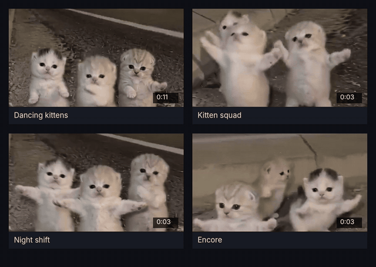

# ClipForge

[](../../actions/workflows/tests.yml)

**[▶ Live demo](https://trump-sudo.github.io/clipforge/)** — real thumbnails and hover previews produced by the pipeline.



A small video-hosting backend built with Laravel 12. You upload a video, a queue worker processes it with **FFmpeg** and **ImageMagick**, and the result shows up in a catalog with tube-style **hover previews**. The catalog is cached in **Redis**, and the whole stack runs with `docker compose up`.

I built it to show the pieces a video platform actually needs: background media processing, caching that survives heavy reads, counters that don't hammer the database, and a dependency on a third-party API that can fail without taking the job down with it.

## Stack

PHP 8.3 · Laravel 12 · MySQL 8 · Redis 7 · FFmpeg · ImageMagick · jQuery · Docker / nginx · PHPUnit · GitHub Actions

## What happens on upload

```
Browser ──(AJAX, progress bar)──▶ VideoController@store
                                    │  validate mime/size, store original (private disk)
                                    ▼
                              Redis queue "media"
                                    │
                                    ▼
                              ProcessVideo job  (tries=2, timeout=600, unique per video)
                                    ├─ ffprobe       → duration, resolution
                                    ├─ ffmpeg        → frame at 30 %
                                    ├─ ImageMagick   → 640×360 center-cropped WebP thumbnail
                                    ├─ ffmpeg        → 6 s preview: 3 segments, concat filter, no audio, +faststart
                                    ├─ status=ready  → catalog cache version bump
                                    └─ Telegram Bot API notification (best effort)
Browser ◀──(polls /status with backoff)── reloads when final
```

## Engineering decisions

| Problem | Solution | Where |
|---|---|---|
| Encoding blocks HTTP requests | Processing runs in a Redis queue worker. `retry_after` (700 s) is set above the job timeout (600 s), so a long encode is never picked up twice | `app/Jobs/ProcessVideo.php`, `.env.example` |
| Duplicate jobs for one video | `ShouldBeUnique` keyed by video id | `ProcessVideo::uniqueId()` |
| Catalog is the hottest read | Pages cached in Redis. Invalidation is a **version counter**: one `INCR` makes every cached page unreachable, and it needs no cache tags | `app/Services/VideoCatalog.php` |
| A view counter is a hot-row `UPDATE` | **Write-behind**: each view is a Redis `HINCRBY`. A scheduled command uses atomic `RENAME` to drain the hash and applies the deltas in one transaction every minute | `app/Services/ViewCounter.php` |
| Grid pages getting heavy | Lightweight WebP thumbnails. The `<video>` preview element is only created on first hover | `resources/views/videos/index.blade.php` |
| Previews that start slowly | `-movflags +faststart` puts the moov atom first, so playback starts before the download finishes | `VideoProcessor::makePreview()` |
| Seeking in the original | `BinaryFileResponse` supports HTTP Range. In production this would be `X-Accel-Redirect` or signed CDN URLs | `VideoController::stream()` |
| Third-party API is down | The Telegram notifier uses a timeout and retries, logs errors instead of throwing, and can't fail the job | `app/Services/TelegramNotifier.php` |
| Shell injection via filenames | All binaries are run through `Process` with **argument arrays**, never string concatenation | `app/Services/VideoProcessor.php` |
| Static assets | nginx serves `/storage` directly with `Cache-Control: immutable` | `docker/nginx/default.conf` |

## Run it

```bash
git clone https://github.com/<you>/clipforge.git && cd clipforge
docker compose up -d --build
# first start runs composer install + migrations (~1–2 min)
open http://localhost:8080
```

Services: `app` (php-fpm), `worker` (queue), `scheduler` (view-count flush), `nginx`, `mysql`, `redis`.

To get a Telegram notification for each processed video, set `TELEGRAM_BOT_TOKEN` and `TELEGRAM_CHAT_ID` in `.env`.

## Tests

```bash
docker compose exec app php artisan test
```

The tests cover upload validation (including rejecting `.php` disguised as a video), queue dispatch, catalog caching and invalidation, the full processing job with a faked `Process` (asserting the actual FFmpeg/ImageMagick arguments), failure handling, and the Telegram integration with a faked HTTP client. CI runs them on every push.

## API

`GET /api/videos?page=1`

```json
{
  "data": [{ "slug": "...", "title": "...", "duration": 42.5, "resolution": "1280x720",
             "thumbnail_url": "...", "preview_url": "...", "url": "..." }],
  "meta": { "page": 1, "per_page": 12, "total": 1 }
}
```

## What I'd add next

- HLS output (multi-bitrate `ffmpeg -f hls`) for adaptive streaming
- Sprite sheets for scrubbing previews on the seek bar
- S3-compatible storage and a CDN for assets
- Horizon for queue monitoring
